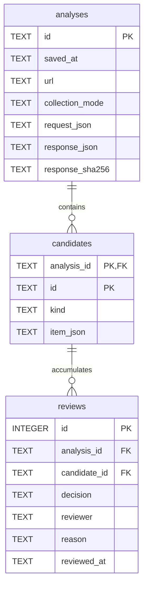
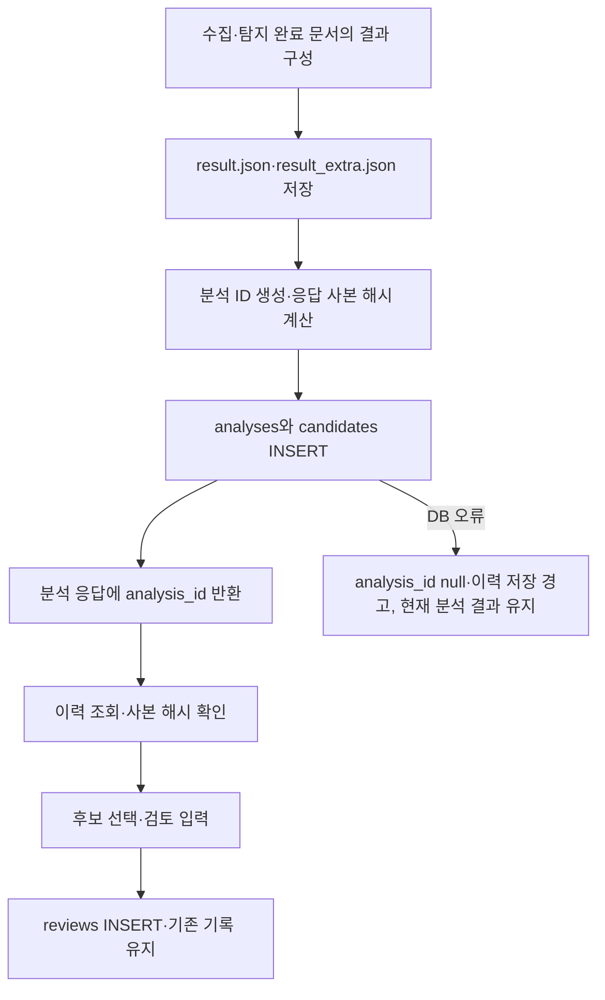

# DB 설계서·ERD

## 1. 저장 목적과 범위

2026-10-25 `backend/app/history.py`의 실제 SQLite DDL과 저장·조회 코드를 기준으로 작성했습니다. 스키마 버전은 `PRAGMA user_version=1`입니다. 분석 요청/결과를 다시 확인하고 후보에 대한 사람의 판단 근거를 누적 보관합니다. 서버형 DB·벡터 DB·RAG·계정 관리는 현재 구현에 포함하지 않습니다.

Windows 저장 경로는 `%LOCALAPPDATA%\YearDream\history.sqlite3`입니다. LOCALAPPDATA가 없으면 `~/.local/share/YearDream/history.sqlite3`를 사용합니다. 실행 파일 옆의 `result.json`·`result_extra.json`과 별개이며, 재배포 폴더를 바꿔도 같은 Windows 사용자라면 같은 DB를 사용할 수 있습니다. 실제 사용자 DB를 배포 묶음에 넣지 않습니다.

## 2. ERD

관계는 분석 1건에 후보 0개 이상, 후보 1건에 검토 기록 0개 이상입니다. `reviews`의 `(analysis_id, candidate_id)`가 **하나의 복합 외래키**로 `candidates(analysis_id, id)`를 참조합니다. ERD의 FK 표시는 두 개의 독립 외래키를 의미하지 않습니다. `reviews.analysis_id`에서 analyses로 직접 선언한 외래키는 없으며 후보를 통해 연결됩니다.

## 3. 테이블 명세

### analyses — 분석 요청·결과 사본

| 컬럼 | SQLite 타입 | 선언된 제약 | 값·용도 |
|---|---|---|---|
| id | TEXT | PRIMARY KEY | `uuid4().hex`로 생성한 분석 ID |
| saved_at | TEXT | NOT NULL | 서버 저장 시각, UTC ISO 8601 |
| url | TEXT | NOT NULL | 분석 시작 URL |
| collection_mode | TEXT | NOT NULL | `static` 또는 `browser` |
| request_json | TEXT | NOT NULL | 분석 요청 모델의 JSON 사본, 한도·모드 포함 |
| response_json | TEXT | NOT NULL | 분석 응답 JSON 사본. result/extra·후보·안내·coverage·규칙 버전 포함 |
| response_sha256 | TEXT | NOT NULL | 저장된 response_json의 UTF-8 바이트 SHA-256 |

응답은 `ensure_ascii=False, sort_keys=True`로 직렬화한 문자열을 저장하고 해시도 같은 문자열로 계산합니다. 저장 시 `analysis_id`는 사본에서 제외하고 API 응답에 나중에 붙입니다. 따라서 사본 내부에 ID가 없어도 정상이며 테이블의 `id`로 식별합니다. `saved_at`은 탐색 시작·페이지 수집 시각과 다릅니다.

### candidates — 분석별 후보 사본

| 컬럼 | SQLite 타입 | 선언된 제약 | 값·용도 |
|---|---|---|---|
| analysis_id | TEXT | NOT NULL, 복합 PK, FK → analyses.id | 소속 분석 |
| id | TEXT | NOT NULL, 복합 PK | `feature-1`, `content-1` 등의 분석 내부 ID |
| kind | TEXT | NOT NULL | `feature`(위장·은닉 특징) 또는 `content`(홍보 내용 후보) |
| item_json | TEXT | NOT NULL | 후보 원문/근거·URL·location·기법/내용 범주·판정 참고 등의 JSON 사본 |

기본키는 `(analysis_id, id)`입니다. 특징 배열과 내용 후보 배열을 각각 1부터 순회해 ID를 부여합니다. 다른 분석에도 `feature-1`이 있을 수 있으므로 ID만으로 후보를 연결하지 않습니다. 재분석 사이 동일 광고를 추적하는 영구 ID나 내용 해시 기반 중복 제거 기능은 아닙니다.

### reviews — 사람의 검토 기록

| 컬럼 | SQLite 타입 | 선언된 제약 | 값·용도 |
|---|---|---|---|
| id | INTEGER | PRIMARY KEY AUTOINCREMENT | 검토 기록 번호 |
| analysis_id | TEXT | NOT NULL, 복합 FK 구성 | 검토 대상의 소속 분석 |
| candidate_id | TEXT | NOT NULL, 복합 FK 구성 | 분석 내부 후보 ID |
| decision | TEXT | NOT NULL | `promotion` / `normal` / `uncertain` |
| reviewer | TEXT | NOT NULL | 검토자, API 기준 공백 제거 후 1~100자 |
| reason | TEXT | NOT NULL | 판단 이유, API 기준 공백 제거 후 1~2,000자 |
| reviewed_at | TEXT | NOT NULL | 서버에서 생성한 UTC ISO 8601 검토 시각 |

검토는 INSERT로 추가하며 기존 기록을 덮어쓰지 않습니다. 조회 시 기록 ID 오름차순으로 모두 반환합니다. 검토 결과는 내용 분류 참고이며 법적 판정이나 필수 4종 제출 승인과 같지 않습니다.

위 표의 열거값·길이·공백 검증은 Python 모델/API의 규칙입니다. 현재 DDL에는 이를 강제하는 CHECK 제약이나 별도 길이 제약이 없습니다. FK에는 ON DELETE CASCADE를 지정하지 않았고, 삭제 API·보존 기간·별도 검색 인덱스도 구현되어 있지 않습니다. SQLite의 PK 인덱스 외에 별도 CREATE INDEX는 없습니다.

## 4. 저장·조회 흐름

연결마다 `PRAGMA foreign_keys=ON`을 적용하고 연결 시간 제한은 3초입니다. 저장 작업은 연결 컨텍스트에서 commit/rollback하며 분석과 후보는 함께 보관합니다. 스키마 초기화 시 CREATE TABLE IF NOT EXISTS를 사용하고 버전 0/1만 허용합니다. 임의의 기존 테이블 구조를 자동 마이그레이션하거나 복구하는 기능은 아닙니다.

| 동작 | 구현·응답 |
|---|---|
| 목록 조회 | 최근 저장 시각·분석 ID 내림차순. 기본 limit 20, 허용 1~100, offset 0 이상. 후보 수는 feature+content 행 수 |
| 상세 조회 | 응답 사본 해시 확인 후 요청·분석·후보·전체 검토 반환. 후보 정렬은 문자열 ID 기준이므로 숫자 자연 정렬과 다를 수 있음 |
| 검토 추가 | 분석/후보 조합이 존재하는지 확인 후 서버 시각과 함께 INSERT |
| 없는 분석/후보 | API 404 |
| DB 접근·버전·사본 체크섬 오류 | 이력 조회/검토 API 503. 분석 중 이력 저장 오류라면 경고와 현재 결과 반환 |

완료 문서가 있는 부분 분석은 안내·coverage와 함께 저장할 수 있습니다. 분석 결과가 전혀 없는 실패나 빈 중단은 새로운 분석 이력으로 저장하지 않습니다. 후보가 0개인 정상 결과는 analyses에 저장할 수 있습니다.

## 5. DB 밖의 데이터와 한계

| 데이터 | 저장 위치·수명 |
|---|---|
| 진행 중 작업·중단 신호·현재 진행 정보 | `AnalysisJobs`의 프로세스 메모리. 최대 20개 작업 보관, 앱 재시작 시 소멸 |
| 같은 탭의 작업 ID | 브라우저 sessionStorage. 메모리 작업 상태 재조회용이며 영구 이력이 아님 |
| 공식 결과 파일 | 실행 파일 옆(소스 실행은 프로젝트 루트). 성공/부분 분석 때 갱신 |
| 검수용 후보 다운로드 | 사용자가 브라우저에서 저장하는 별도 JSON |
| 전체 HTML·렌더링 관찰값 | 이력 DB에는 저장하지 않음. 별도 오프라인 capture 도구의 로컬 검증 폴더 사용 |

DB 응답 해시는 저장된 문자열 불일치 확인용이며 전자서명·접근 제어·변조 방지를 제공하지 않습니다. 검토를 추가해도 저장된 분석 사본·자동 제출 후보·기존 결과 파일은 변경하지 않습니다. 현재 구조는 로컬 단일 사용자용이며 계정·권한·정기 백업·재분석 비교·유사 사례 검색은 구현하지 않았습니다.

화면 연결은 [화면설계서](SCREEN_DESIGN.md), API 개요는 [wiki](../wiki.md), 실제 확인 범위는 [project.md](../project.md)를 참조합니다. ERD에 등장하는 세 테이블만 현재 영구 저장 구조이며 향후 플랫폼/RAG 계획과 구분합니다.
