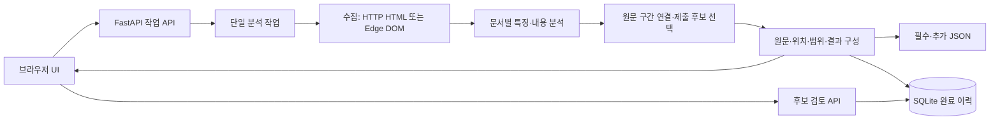
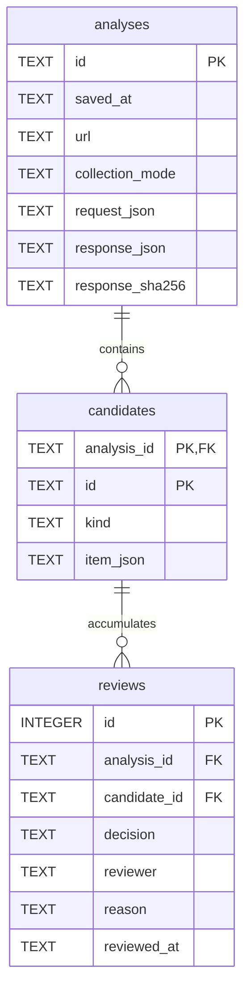

# 공공 웹사이트 불법광고 탐지 도구 프로젝트 — PPT 제작용 통합 기획서·완성 프롬프트

- 작성 기준일: 2026-10-26 (Asia/Seoul)
- 대상 구현: release-20261025-08 및 현재 저장소 문서
- 목적: 이 문서 전체를 다른 AI 도구에 전달해 **15장 발표용 PPT**를 제작하기

## 1. AI 도구에 전달할 제작 지시

당신은 소프트웨어 프로젝트를 평가하는 강사에게 보여줄 발표 자료를 만드는 기획자이자 프레젠테이션 디자이너입니다. 이 문서의 확인된 사실과 슬라이드별 설계를 바탕으로 한국어 PPT를 완성하세요. 추가 저장소 접근 없이도 제작할 수 있도록 필요한 내용과 도식 정보를 아래에 제공했습니다.

### 제작 목표

- 프로젝트 이름은 **공공 웹사이트 불법광고 탐지 도구 프로젝트**로 정확히 표기하세요.
- 총 **15장**, 표지 포함으로 제작하세요. 별도 목차·감사·부록 슬라이드를 임의로 추가하지 마세요.
- 강사가 중요하게 보는 **기능 명세·화면설계·ERD·구현 기능 설명**에 가장 많은 비중을 두세요. 배경과 미래 구상은 짧게 제시하세요.
- 발표 시간은 약 10~15분으로 가정하되 핵심 기술 설명은 발표자 노트로 보완하세요.
- 기능을 나열하는 데 그치지 말고 ‘사용자가 하는 행동 → 시스템 처리 → 결과 → 설계 이유’를 연결하세요.

### 출력물과 표현

- PPTX 생성이 가능하면 편집 가능한 도형·표·텍스트로 된 PPTX를 제공하세요. 가능하면 PDF 미리보기도 함께 제공하세요.
- 파일 생성이 불가능하면 15장의 제목·본문·도식 배치·발표자 노트를 구분한 최종 슬라이드 원고를 제공하세요. 파일을 만들지 않았다면 생성했다고 말하지 마세요.
- 16:9 화면, 흰색 또는 밝은 회색 배경, 진한 남색 제목, 파란색 강조를 기본으로 사용하세요. 개선 필요 항목은 주황색으로 구분하세요.
- 제목 약 30~36pt, 본문 약 20~24pt를 권장합니다. 한 장에는 핵심 메시지 하나와 짧은 본문 3~5개 수준을 유지하세요. 표·ERD의 세부 설명은 노트로 옮겨 가독성을 확보하세요.
- 표는 비교·명세에, 도식은 처리 흐름·화면 이동·ERD에 사용하세요. 긴 문단이나 전체 코드 화면을 슬라이드에 붙이지 마세요.
- 도식은 가능하면 편집 가능한 요소로 다시 그리세요. 아래 Mermaid 코드를 슬라이드 본문에 문자 그대로 노출하지 마세요.
- 발표자·소속·발표일은 `[발표자명]`, `[소속]`, `[발표일]`로 남겨 두세요. 알 수 없는 이름이나 기관을 만들지 마세요.

### 사실을 지키는 규칙

1. 현재 제품은 사용자 PC에서 실행하는 **로컬 탐지·검토 도구**입니다. 중앙 서버에 배포한 다중 사용자 플랫폼으로 설명하지 마세요.
2. 현재 외부 AI API·생성형 모델·RAG·벡터 DB는 사용하지 않습니다. 탐지는 규칙과 DOM/스타일 분석 기반이며, AI 코딩 도구 활용과 제품의 AI 추론을 혼동하지 마세요.
3. 337개 테스트 통과는 기능 회귀 검사 기록입니다. 탐지 정확도 100%나 공모전 채점 통과로 변환하지 마세요.
4. 검출 위치 수·반복 문구 수·고유 광고 수를 구분하세요. 후보400개를 불법광고400건이라고 표기하지 마세요.
5. 알려진 JAMO 검출과 후보 중복 표시 문제는 **개선 필요·미수정**, 플랫폼/RAG는 **미구현·보류**로 표시하세요.
6. 같은 호스트와 설정 한도 내 분석이며 전수 탐지를 보장하지 않습니다. 100문서·깊이4·25분은 사용자가 바꿀 수 있는 시험 기본값입니다.
7. 실제 스크린샷이 이 문서에 첨부되지 않았다면, 7·8장은 제공한 구성에 따라 **화면설계도**로 그리세요. 설계도를 실제 실행 캡처로 표현하지 마세요. 화면에 임의 검출 수치나 검토자를 채우지 마세요.
8. 관계도에 계정·기관·벡터·작업 테이블을 임의로 추가하지 마세요. 현재 영구 저장 테이블은 analyses·candidates·reviews 세 개입니다.
9. 공식 요구조건과 자체 구현 선택을 구분하세요. 공모전은 특정 프레임워크·DB·문서100개 제한을 지정하지 않았습니다.
10. 수상·공식 접수 완료·전체 사이트 검증·측정하지 않은 시간 절감률이나 정확도를 만들지 마세요. 외부 통계·출처 없는 시장 수치는 추가하지 마세요.

## 2. 발표에 사용할 확정 사실

### 제품과 기술

| 항목 | 발표 기준 |
|---|---|
| 목적 | 공공 웹사이트의 게시·은닉 광고를 탐색하고 원문·요소 위치·검토 후보를 제공 |
| 실행 형태 | Windows 실행 파일 → 로컬 FastAPI/Uvicorn 서버 → 브라우저 UI |
| 분석 대상 | 공개 HTTP(S) 페이지와 같은 netloc의 허용 링크·게시글·댓글·iframe. 자동 클릭/스크롤/로그인은 미지원 |
| 기본 분석 | httpx로 응답 HTML 수집, BeautifulSoup4/html5lib 기반 DOM 분석 |
| 동적 분석 | Playwright와 설치된 Microsoft Edge로 JS 실행 후 DOM·계산 스타일·좌표 관찰 |
| 필수 특징 | HOMOGLYPH·JAMO·TRANSPARENT·OFFSCREEN |
| 내용 후보 | GAMBLING(도박 홍보), ADULT_CONTENT(성인물 홍보) |
| 정책 | 특징 발견과 홍보 내용·제출 선택을 분리. 관련 홍보 원문 구간과 겹치는 특징만 자동 제출 후보로 선택 |
| 저장 | 필수 result.json·추가 result_extra.json, SQLite 분석 이력·사람의 검토 기록 |
| 현재 상태 | 로컬 기능 구현·문서 정리. 최신 실행본은 release-20261025-08 |

### 설정·작업·출력

| 설정 | 화면 기본값 | 변경 범위 |
|---|---:|---:|
| 문서 한도 | 100개 | 1~1,000개 |
| 링크 깊이 | 4단계 | 0~20단계 |
| 시간 예산 | 25분 | 1~30분 |

문서 한도에는 실패한 수집 시도와 iframe 컨텍스트도 포함됩니다. 링크 깊이는 시작 URL을0으로 보고 링크 이동마다1 증가하며 iframe 진입 깊이는 별도로 제한합니다. 시간 예산·문서 한도에 도달하거나 방문할 링크가 소진되면 종료할 수 있습니다. 진행 중 처리는 협력적으로 정리하므로 시간 예산을 엄격한 강제 종료 보장으로 설명하지 않습니다.

화면은 POST /api/jobs로 분석을 시작하고 약500ms마다 진행 상태를 조회합니다. 한 번에 분석 하나를 실행하며 중단 시 완료한 문서의 결과를 반환합니다. 작업은 메모리에 최대20개 보관되며 앱 재시작 시 소멸합니다. 완료 이력은 SQLite에 영구 저장됩니다. 기존 동기 호환 POST /api/analyze의 기본값8문서·깊이2·60초는 화면 기본값과 다릅니다. 이 API 비교는 발표자 노트용이며 본문을 복잡하게 만들 필요는 없습니다.

공식 결과 파일은 실행 파일 옆에 생성합니다. 소스 실행에서는 프로젝트 루트입니다. DB는 Windows의 `%LOCALAPPDATA%\YearDream\history.sqlite3`에 별도로 저장합니다. 화면의 세 다운로드는 필터와 무관하게 마지막 분석의 해당 전체 결과를 저장합니다.

### 실제 사례와 검증 수치 — 서로 다른 실행을 섞지 않기

발표 14장은 다음 **사용자 이력400개 사례**를 중심으로 구성하세요.

| 항목 | 확인한 내용 |
|---|---|
| 진입 URL | `https://gen.go.kr/child/main/main.php` |
| 근거 자료 | 사용자가 복사해 제공한 선택된 분석 이력 텍스트 |
| 해당 저장 시각 | 2026-10-25T14:33:50.457618+00:00 |
| 전체 후보 | 400개 = 홍보 내용385개 + JAMO 특징15개 |
| 홍보 내용 구성 | 성인물230개 + 도박155개 |
| 목표 게시글 | 어린이 홈페이지 게시판 `tbnum=6`, `number=107` |
| 본문 도달 근거 | 제목44자·본문4,916자가 각각 GAMBLING 후보로 기록됨 |
| 해당 페이지의 후보8개 | 제목·본문2개 + 페이지에 함께 표시된 목록 문구6개 |
| 반복 관찰 | 홍보385개를 공백 정리해 비교하면 원문46종. 고유 광고46개라는 뜻은 아님 |
| 수집 실패 | 해당 이력에15번 게시글 실패가 표시됨. 원인은 텍스트에 없음 |
| 한계 | 원본 응답JSON·전체coverage 미제공. 전체 방문 범위·미탐·정확도는 이 자료로 확정할 수 없음 |

337개 Python 테스트 통과와 Node·Edge·패키지 검사는 별도의 기능 검증 근거입니다. release-07은 전체 패키지 흐름 검사를 했고, release-08은 문구/설명서 갱신 후 해시·실제 제공HTML 일치와 Node 회귀를 확인했습니다. 최신 문구 버전에서337개를 새로 반복 실행했다는 표현은 쓰지 마세요.

이전325개 후보 실행의 ‘100회 시도·99문서 분석·실패1·3분6초’, 개발용 시험의 ‘100문서·83.1초’는 **별도 실행**입니다. 400개 사례에 이 수치를 붙이지 마세요. 본 발표에서는 혼선을 줄이기 위해 이 별도 실행 수치는 생략해도 됩니다.

## 3. 슬라이드별 최종 구성

### 슬라이드 1. 표지

**핵심 메시지:** 공공 웹사이트의 광고 후보를 탐색하고 근거와 검토 이력을 남기는 로컬 도구.

**화면 문구**

- 공공 웹사이트 불법광고 탐지 도구 프로젝트
- URL 탐색 · 위장/은닉 특징 분석 · 원문/위치 제공 · 검토 이력 관리
- [발표자명] · [소속] · [발표일]

**시각 구성:** 큰 제목과 URL → 분석 → 결과 → 검토의 작은 아이콘 흐름. 실제 기관 로고나 수상 표시는 넣지 않습니다.

**발표자 노트:** “입력한 공공 웹사이트 URL에서 게시글과 프레임을 탐색하고, 광고 후보의 원문과 위치를 확인할 수 있도록 만든 프로젝트입니다. 기능 명세와 화면·DB 설계를 중심으로 설명하겠습니다.”

### 슬라이드 2. 문제 정의와 개발 목적

**핵심 메시지:** 광고 문구 발견에서 끝내지 않고 어떤 페이지·요소에서 발견했는지 제공해야 합니다.

**화면 문구**

- 게시판·댓글·iframe 등 여러 영역에 홍보 문구가 존재
- 유사 문자·자모·투명 스타일·화면 밖 배치로 표현을 바꿀 수 있음
- 링크 탐색과 특징 분석, 원문·위치 확인을 하나의 흐름으로 연결

**시각 구성:** ‘찾아가기 → 분석하기 → 근거 남기기’의3단 구조. 확인되지 않은 피해 규모·통계는 넣지 않습니다.

**발표자 노트:** “메인 화면만 확인해서는 하위 게시글의 내용을 놓칠 수 있습니다. 이 도구는 공개 링크를 따라가며 수집한 범위에서 표현과 표시 상태를 분석하고, 사람이 확인할 근거를 남기는 데 목적이 있습니다.”

### 슬라이드 3. 프로젝트 범위와 제공 형태

**핵심 메시지:** 사용자 PC 안에서 분석과 기록 관리를 수행합니다.

**화면 문구**

- Windows 실행 파일로 시작하는 로컬 웹 도구
- 기본 HTML 분석 / Edge 기반 동적 분석 선택
- 결과 JSON과 SQLite 이력·검토 기록 저장
- 외부 AI API·생성 모델·RAG는 사용하지 않음

**시각 구성:** ‘사용자PC’ 경계 안에 실행 파일·로컬 서버·브라우저·DB/결과 파일, 경계 밖에 분석 대상 웹사이트를 배치합니다. 외부 연결은 사이트 수집으로 표시합니다.

**발표자 노트:** “웹 화면을 사용하지만 중앙 서비스로 배포한 플랫폼은 아닙니다. 각 PC에서 서버와 화면을 실행하고 데이터를 보관합니다. 현재 광고 후보 판별은 규칙과 DOM/스타일 분석이며 생성형 AI 추론을 사용하지 않습니다.”

### 슬라이드 4. 핵심 기능 명세

**핵심 메시지:** 사용자 입력과 처리 결과·예외 동작을 연결해 기능을 정의했습니다.

**화면 표**

| 기능 | 입력 | 주요 처리 | 출력 |
|---|---|---|---|
| 분석 시작 | URL·모드·한도 | 입력 검증·단일 작업 생성 | 작업ID·진행 상태 |
| 특징/내용 분석 | HTML·DOM·스타일 | 4종 특징·홍보 내용·제출 선택 구분 | 원문·위치·후보 |
| 중단·결과 확인 | 작업ID·중단 요청 | 완료 문서 보존·부분 결과 구성 | 결과·미분석 안내 |
| 후보 검토 | 분석/후보·판단·검토자·이유 | 대상 검증·검토 기록 추가 | 누적 검토 이력 |

**시각 구성:** 입력/처리/출력 표를 중앙에 크게 배치하고 아래에 ‘오류·0건·부분 완료 구분’ 한 줄을 강조합니다.

**발표자 노트:** “요구사항은 수집·필수4종·위치·결과 제공이고, 기능 명세는 이를 실제 입력과 처리·예외 동작으로 풀어낸 것입니다. 입력 오류는 거부하고, 수집 실패를 정상0건으로 표시하지 않으며, 중단해도 완료된 문서는 보존하도록 정했습니다.”

### 슬라이드 5. 전체 시스템 아키텍처

**핵심 메시지:** 수집·탐지·결과 변환·기록 저장을 역할별로 나눴습니다.

**화면 문구**

- Frontend: 입력·상태·결과·검토
- FastAPI: 작업 생성·조회·중단·이력 API
- 수집/탐지: 문서별 수집 후 즉시 분석
- 결과/저장: JSON 변환과 SQLite 기록

**시각 구성:** 아래 아키텍처 도식을 사용합니다. SQLite와 JSON은 같은 결과 경로의 별도 저장 대상이며, 크롤러와 탐지기가 한 번만 순서대로 끝나는 배치처럼 그리지 말고 ‘문서별 반복’으로 표시합니다.

**발표자 노트:** “UI가 분석 작업을 만들면 서버가 문서를 수집하는 대로 분석합니다. 탐지기는 원문과 요소 위치를 보존하고, 결과 변환과 DB 저장은 별도 역할로 처리합니다. 진행 중 작업과 완료 이력의 수명도 구분했습니다.”

### 슬라이드 6. 사용자 이용 흐름

**핵심 메시지:** 분석과 사람이 판단하는 검토를 연결합니다.

**화면 문구**

1. URL·분석 방식·한도 입력
2. 탐지 실행·진행 확인
3. 원문·위치·실제 분석 범위 확인
4. 결과 다운로드 또는 이력 상세 이동
5. 검토자·이유와 함께 판단 기록

**시각 구성:** 사용자 행동을5단 흐름으로 그립니다. 2단계에서 ‘중단 → 완료 문서의 부분 결과’ 분기를 추가합니다. ‘수동 검토 → 자동 제출 승인’ 화살표는 만들지 않습니다.

**발표자 노트:** “프로그램이 제시하는 것은 검토할 후보입니다. 사용자는 원문과 수집 범위를 확인한 뒤 판단과 근거를 기록합니다. 이 판단을 기록해도 기존 분석이나 제출 JSON을 자동 변경하지 않습니다.”

### 슬라이드 7. 분석 화면 설계

**핵심 메시지:** 입력·진행·결과·범위를 한 화면에서 구분합니다.

**화면 문구**

- ① 입력: URL·분석 방식·유형 필터·한도
- ② 진행: 실제 처리 건수·현재URL·경과 시간·중단
- ③ 결과: 특징/내용 후보·다운로드·안내 묶음
- ④ 범위: 수집/분석·미방문/제외 상세

**시각 구성:** 아래 분석 화면설계도를4개 영역으로 나누고 번호를 붙입니다. 실제 캡처가 별도 제공되면 같은 번호로 주석을 달아 대체합니다. 세부 텍스트는 설계도에 모두 채우지 않습니다.

**발표자 노트:** “사용자가 조절하는 값과 결과 필터를 구분했습니다. 작업의 전체 분모를 알 수 없어 가짜 퍼센트 대신 실제 건수를 보여줍니다. 긴 안내는 사유별로 묶고, 개별 주소는 펼쳐보게 해 결과를 읽기 쉽게 했습니다.”

### 슬라이드 8. 이력·후보 검토 화면 설계

**핵심 메시지:** 분석 결과와 사람이 남긴 판단을 함께 다시 확인합니다.

**화면 문구**

- 분석 목록: 저장 시각·분석 방식·후보 수·URL
- 상세: 규칙 버전·원문·페이지·요소 위치
- 검토: 홍보 / 정상 / 보류 + 검토자·판단 이유
- 기존 검토를 유지하면서 새 기록 추가

**시각 구성:** 아래 이력 화면설계도를 기반으로 실제 구현처럼 ‘위쪽 목록 → 아래쪽 상세’로 배치합니다. 별도 관리자 페이지나 로그인 화면을 추가하지 않습니다.

**발표자 노트:** “목록은20개씩 조회하고 URL 버튼을 선택하면 같은 화면 아래에서 상세를 봅니다. 검토자와 이유를 필수로 입력하고 기록은 누적합니다. 검토 기록을 수정·삭제하거나 제출 승인으로 바꾸는 기능은 구현하지 않았습니다.”

### 슬라이드 9. 탐색 기능 — 기본·동적 분석과 범위 제어

**핵심 메시지:** 페이지 특성에 따라 수집 방식을 선택하고 탐색 범위를 조절합니다.

**화면 표**

| 구분 | 기본 분석 | 동적 페이지 분석 |
|---|---|---|
| 읽는 대상 | HTTP 응답 HTML | JS 실행 후 DOM·계산 스타일 |
| 활용 | HTML에 이미 있는 본문·링크 | JS 생성 본문·댓글·스타일 관찰 |
| 유의점 | JS 생성 내용이 없을 수 있음 | 대기·자원 소모, 클릭 이후 내용은 보장하지 않음 |

아래에 ‘게시판·게시글 우선 탐색 / 문서100·깊이4·25분은 변경 가능’ 표시.

**시각 구성:** 비교 표와 작은 ‘메인 → 게시판 → 게시글’ 도식. 입력 범위의 전체 숫자는 발표자 노트에 둡니다.

**발표자 노트:** “동적 분석은 더 많은 렌더링 정보를 관찰하는 방식이지 항상 더 정확한 판정이라는 뜻은 아닙니다. 문서는1~1000개, 깊이는0~20, 시간은1~30분으로 바꿀 수 있습니다. 같은 호스트와 한도 안에서 탐색하며 읽기와 관련 없는 작업 링크·첨부파일은 제외합니다.”

### 슬라이드 10. 탐지 기능 — 특징·내용·제출 후보의 구분

**핵심 메시지:** 표현/은닉 특징을 발견했다고 곧바로 광고로 확정하지 않습니다.

**화면 표**

| 4종 특징 | 분석 관점 |
|---|---|
| HOMOGLYPH | 닮은꼴 문자 사용 |
| JAMO | 분리된 한글 자모 |
| TRANSPARENT | 투명도·글자색/배경 등 표시 상태 |
| OFFSCREEN | 작은 글꼴·숨김·문서 음수 영역 배치 등 |

**시각 구성:** 표 옆에 ‘특징 분석 + 도박/성인물 홍보 문맥 → 관련 원문 구간 확인 → 제출 후보 또는 검토 필요’ 흐름을 그립니다. ‘일반 표시 홍보 → 추가 후보’는 별도 가지로 둡니다.

**발표자 노트:** “내용 규칙은 관련 주제와 검색·이용 유도 표현을 확인하고 예방/신고 등의 문맥을 구분합니다. 관련 홍보 원문 구간과 겹치는 특징만 현 정책의4종 제출 후보로 선택합니다. 일반 표시 홍보에는 없는 기법을 붙이지 않습니다. 이 규칙도 법적 확정이나 전체 정확도 보장은 아닙니다.”

### 슬라이드 11. 결과 제공 — 근거·위치·범위 보존

**핵심 메시지:** 사람이 다시 확인할 수 있는 원문과 요소 위치를 제공합니다.

**화면 문구**

- 원문: 설명용 문구와 실제 제출 근거 분리
- 위치: URL + CSS selector, iframe 경계는 `>>>`
- 파일: 필수 / 추가 / 검수용 결과 구분
- 범위: 분석 완료·실패·미방문/제외를 함께 안내

**시각 구성:** ‘내용 범주·원문·URL·location·검토 필요’를 표시한 **설명용 결과 카드**와3개 파일을 그립니다. 예시 선택자는 `iframe#outer >>> p.notice`로 표시하고 실제 사이트 캡처가 아님을 노트에 명시합니다. 전체 JSON을 코드 덩어리로 넣지 않습니다.

**발표자 노트:** “제출 근거는 정규화 전 원문을 보존합니다. 필수 결과는 result.json, 일반 표시 홍보 등의 추가 결과는 result_extra.json, 범위·안내를 포함한 검수 자료는 content-candidates.json입니다. 필터는 화면 표시만 바꾸며 다운로드 원본은 유지합니다.”

### 슬라이드 12. ERD — 분석·후보·검토의 관계

**핵심 메시지:** 한 분석에 여러 후보, 한 후보에 여러 검토 기록을 연결합니다.

**화면 문구**

- analyses: 분석 요청·응답 사본
- candidates: 분석 내부의 특징/홍보 후보
- reviews: 판단·검토자·이유·시각
- 후보 식별은 분석ID + 후보ID의 복합키

**시각 구성:** 아래 ERD의 세 테이블과0..N 관계를 크게 그립니다. PK/FK와 복합키 필드를 강조하고 부가 필드는 작은 글씨로 과밀하게 채우지 말고 노트에 보완합니다. reviews에서 analyses로 직접 FK 화살표를 추가하지 않습니다.

**발표자 노트:** “후보ID는 feature-1, content-1처럼 분석 안에서 부여되므로 다른 분석에서도 반복될 수 있습니다. 따라서 분석ID와 묶어 식별합니다. reviews의 두 필드가 하나의 복합 외래키로 후보를 참조해 다른 분석의 후보와 섞이지 않도록 구성했습니다.”

### 슬라이드 13. DB 기능과 도입 효과

**핵심 메시지:** 실행 결과를 일회성 파일에서 다시 확인할 수 있는 기록으로 확장했습니다.

**화면 표**

| 구현 기능 | 제공하는 가치 |
|---|---|
| 요청 설정·응답·규칙 버전 사본 | 당시 분석 결과와 설정 재조회 |
| 후보별 검토 누적 | 누가 왜 판단했는지 추적 |
| 재실행 후 이력 유지 | 프로그램을 다시 열어 기록 확인 |
| DB 저장 실패를 별도 경고 | 현재 분석·다운로드의 이용 유지 |

**시각 구성:** ‘분석 사본 저장 → 후보 확인 → 검토 기록 추가 → 재조회’ 순환 도식. 저장 항목과 효과를 연결하되 효율 개선률은 넣지 않습니다.

**발표자 노트:** “DB를 넣은 이유는 이력 재조회와 판단 근거 보존입니다. 현재PC의 검토 필드·재실행 유지와 다른PC의 정상 작동/기록 유지 보고를 받았습니다. 이는 정량적 시간 절감 실험과 다르며, SHA-256 사본 해시는 불일치 확인용이지 전자서명이나 변조 방지 장치는 아닙니다.”

### 슬라이드 14. 실제 실행 근거와 검증 범위

**핵심 메시지:** 메인에서 목표 게시글의 제목·본문까지 분석한 근거를 확인했습니다.

**화면 문구**

- 진입: 광주광역시교육청 어린이 홈페이지 메인
- 도달: 게시판107번 제목44자·본문4,916자 → 도박 홍보 후보
- 이력400개: 내용385개 + JAMO 특징15개
- 별도 기능 검증: Python337개 회귀 검사와 Node·실제 Edge 검사

**시각 구성:** ‘메인 → 게시판 →107번 글 → 제목/본문 후보’ 경로와 두 근거 상자를 분리합니다. 하나는 사용자 복사 이력, 다른 하나는 기능 회귀 검사입니다. 제목/본문 글자 수를 정확도나 탐지율 차트로 그리지 않습니다.

**발표자 노트:** “이 사례에서는 링크 발견뿐 아니라4,916자 본문이 후보로 기록되어 실제 본문 도달을 확인했습니다. 전체400개는385개 내용 후보와15개 특징의 합입니다. 목록 문구가 여러 페이지에서 반복되므로 고유 광고400건이 아닙니다. 원본JSON·전체coverage와 정답 전수 검수가 없으므로 정확도·재현율은 제시하지 않습니다.”

### 슬라이드 15. 개선 과제와 향후 방향

**핵심 메시지:** 현재의 한계를 명시하고 확장은 필요성과 검증 기준에 따라 판단합니다.

**화면 문구 — 두 열로 구분**

| 현재 개선 필요·미수정 | 향후 확장·미구현/보류 |
|---|---|
| 목록·본문의 반복 후보를 사용자 관점에서 요약 | 점검 대상·재분석 비교 등 DB 활용 확대 |
| 아래아(ㆍ)를 사용한 정상 행정 문구의 JAMO 검출 | 출처·검수 상태를 갖춘 사례 검색 |
| 실패 원인·미검수 범위의 근거 보강 | 공동 이용 플랫폼·로컬 RAG 검토 보조 |

**시각 구성:** 왼쪽은 현 제품의 개선 과제, 오른쪽은 보류한 확장으로 구분합니다. 하단 마무리 문장은 ‘탐색·분석·원문/위치·검토 기록을 연결한 로컬 도구’로 작성합니다.

**발표자 노트:** “정상 행정 문구15개가 아래아 때문에 검토 대상으로 잡힌 문제와 반복 후보의 검토 부담을 확인했습니다. 현재는 코드 수정을 멈추고 문서 정리 상태이며 이 문제를 해결했다고 말하지 않습니다. RAG는 관련 사례를 찾아 설명하는 용도로 향후 검토할 수 있지만 지금은 모델·검색 구조가 미선정이고 구현하지 않았습니다.”

## 4. 도식·화면설계 자료

다음은 PPT 제작자가 편집 가능한 그림으로 옮길 원본 정보입니다. 별도 슬라이드를 늘리지 말고 지정된 장에 사용하세요.

### 5장 아키텍처 도식



작업은 여러 문서를 순차 수집/분석하며 위 그림은 각 문서의 논리적 흐름입니다. 외부 대상 사이트가 도식에 필요하면 수집 노드와 연결하고 그 사이트의 DB에 접근하는 것으로 그리지 마세요.

### 7장 분석 화면설계도

```text
[프로젝트 제목] [분석 이력·후보 검토 관리 링크]
┌ ① 입력 ────────────────────────────────────┐
│ [URL] [기본/동적 분석] [유형 필터] [탐지 실행] │
│ [문서 한도] [링크 깊이] [시간 예산(분)]        │
└────────────────────────────────────────────┘
┌ ② 진행 ────────────────────────────────────┐
│ [실행 상태] [움직이는 진행 막대]              │
│ 수집/분석·대기·실패·현재URL·경과 시간         │
│ [중단하고 현재 결과 보기]                    │
└────────────────────────────────────────────┘
┌ ③ 결과 ────────────────────────────────────┐
│ [필수 JSON] [광고 후보] [추가 결과 다운로드]   │
│ 요약 / ▶ 안내 사유별 건수                    │
└────────────────────────────────────────────┘
┌ ④ 범위·상세 ───────────────────────────────┐
│ 실제 탐색·분석 범위 / ▶ 문서별 상세           │
│ 위장·은닉 특징 카드 / 홍보 내용 후보 카드     │
│ ▶ 상세 JSON                                │
└────────────────────────────────────────────┘
```

실행 중 URL·모드·한도·실행 버튼은 잠기고 중단 요청을 제공합니다. 결과 안내는 유형별 접힘이며 원문 목록은 펼쳐 확인합니다. 실제 수치가 없는 설계도에는 임의 결과를 채우지 마세요.

### 8장 이력·검토 화면설계도

```text
[탐지 화면으로] 분석 이력·후보 검토
[이력 새로고침] [목록 상태 안내]
┌ 분석 목록 ─────────────────────────────────┐
│ 저장 시각·모드·후보 수 / [분석 URL 선택]      │
│ [이전] [다음]                              │
└────────────────────────────────────────────┘
┌ 선택한 분석 상세 ──────────────────────────┐
│ URL·저장 시각·규칙 버전·분석 안내            │
│ 후보: 기법/범주·원문·페이지·위치            │
│ 기존 검토: 시각·검토자·판단·이유            │
│ [홍보/정상/보류] [검토자] [판단 이유]        │
│ [검토 기록 추가] [저장 결과 안내]            │
└────────────────────────────────────────────┘
```

검토자와 이유는 필수이며 최대100자·2,000자입니다. 저장 중 중복 입력을 막고 성공 후 기존 검토 아래에 기록을 추가합니다. 이력 상세의 분석 안내는 현재 개별 문단이며 분석 화면과 같은 유형별 묶음으로 그리지 마세요.

### 12장 ERD 원본



**관계 해석·발표자 노트용**

- analyses.id: UUID 분석ID. 요청/응답 사본과 저장 시각·응답 SHA-256 보관.
- candidates의 기본키: `(analysis_id, id)`. analysis_id는 analyses.id를 참조. kind는feature/content, item_json은 후보 사본.
- reviews.id: 자동 증가 검토ID. decision·reviewer·reason·reviewed_at 보관.
- reviews의 `(analysis_id, candidate_id)`가 candidates의 `(analysis_id, id)`를 참조하는 **하나의 복합 외래키**. 두 개의 독립 관계로 그리지 않기.
- 분석1건 → 후보0개 이상, 후보1건 → 검토0개 이상. 후보가 없어도 분석 사본을 저장할 수 있음.
- 검토는 추가 저장. 기존 분석 사본과 제출 JSON은 변경하지 않음.
- 실행 중 작업은 메모리 데이터이며 현재 jobs 테이블은 없음. 로그인·사용자·벡터 테이블도 없음.

## 5. 발표 제작 전 최종 확인

- [ ] 정확한 프로젝트 이름, 표지 포함15장인가?
- [ ] 명세·화면설계·기능·ERD가 발표 중심인가?
- [ ] 화면설계도와 실제 실행 캡처를 구분했는가?
- [ ] 기본/동적 분석의 차이를 ‘항상 더 정확함’으로 단순화하지 않았는가?
- [ ] 100·4·25를 고정 최대치나 공식 조건으로 쓰지 않았는가?
- [ ] 실제 ERD의 세 테이블·복합키·0..N 관계를 유지했는가?
- [ ] 후보400개·홍보385개·JAMO15개를 구분하고 다른 실행 수치를 섞지 않았는가?
- [ ] 337개 테스트를 기능 검사 기록으로 설명했는가?
- [ ] 미수정 문제와 미구현/보류 확장을 구분했는가?
- [ ] 핵심 메시지·짧은 본문·시각 자료·발표자 노트가 각 장에 있는가?

## 6. 원자료 추적표 — 추가 슬라이드로 만들지 않기

이 기획서는 핵심5문서의 반복 내용을 발표 주제별로 통합했습니다. 작업 원칙·초기 개발 지시·과거 버전 나열·설치 명령은 발표에서 줄이고 실제 기능·설계를 중심으로 재구성했습니다. 화면/DB 상세는 핵심 문서가 참조하는 두 설계서를 보충했습니다. 아래 링크는 원자료 확인용이며 PPT를 만드는 AI가 다시 읽지 않아도 본문의 데이터로 제작할 수 있습니다.

| 원자료 | 통합에 사용한 내용 | 주요 슬라이드 |
|---|---|---|
| [요구사항정의서](../요구사항정의서.md) | FR/NFR·FS 입력/처리/출력/예외, 공식/자체 정책 구분 | 2·4·9~11 |
| [wiki](../wiki.md) | 현재 구조·수집/탐지·API/결과 계약·확장 방향 | 3·5·9~11·15 |
| [README](../README.md) | 제품 형태·실행·설정·결과 이용 개요 | 3·6·9·11 |
| [project](../project.md) | 현재 검증·107번 본문 도달·400개 이력·알려진 한계 | 13~15 |
| [project-guide](../project-guide.md) | 현재 범위 준수·근거 구분·미확인 과장 금지 | 전체의 표현 기준 |
| [화면설계서](SCREEN_DESIGN.md) | 두 화면·상태·필터·진행·중단·검토 입력 | 6~8 |
| [DB 설계서·ERD](DATABASE_DESIGN.md) | 실제 테이블·복합키/외래키·저장/조회 흐름 | 12~13 |

이 문서는 **발표 제작을 위한 기획·프롬프트**입니다. 실제 PPT·새 기능·수정된 실행 파일·공식 제출 묶음을 생성했다는 뜻은 아닙니다. 제작 도구에는 이 파일 전체를 전달해 사용하세요.
