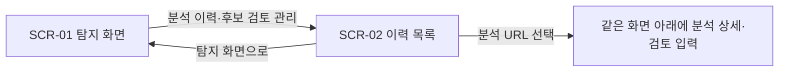

# 화면설계서

## 1. 범위와 기준

2026-10-25 소스 및 release-20261025-07의 화면 구성과 release-08의 범위 안내 문구를 기준으로 작성했습니다. 현재 제품은 로컬 실행 도구이며 브라우저로 접속합니다. 본 문서는 구성·상태·상호작용을 설명합니다. 실행 절차는 [사용 설명서](USER_MANUAL.md), 기능의 입력·출력·예외는 [기능 동작 명세](../요구사항정의서.md#6-기능-동작-명세)를 따릅니다. 별도 로그인·회원·관리자 화면은 구현되어 있지 않습니다.

| 화면 ID | 이름 / 경로 | 구현 파일 |
|---|---|---|
| SCR-01 | 탐지·분석 결과 / `/` | `frontend/static/index.html` |
| SCR-02 | 분석 이력·후보 검토 / `/history` | `frontend/static/history.html` |



## 2. SCR-01 탐지·분석 결과

화면은 아래 순서로 구성됩니다. 좁은 화면에서는 입력 요소를 세로로 배치합니다.

```text
불법광고 탐지 도구
분석 이력·후보 검토 관리 링크
[URL] [분석 방식] [결과 유형 필터] [탐지 실행]
[문서 한도] [링크 깊이] [시간 예산(분)]
설정 범위·동적 분석 안내
실행 상태 / 진행 막대 / 실제 처리 건수·현재 URL·경과 시간
[중단하고 현재 결과 보기]
[JSON 다운로드] [광고 후보 다운로드] [추가 탐지 결과 다운로드]
▶ 결과 파일과 판정 기준 안내
분석 결과 요약
▶ 분석 안내: 사유별 건수·개별 원문
실제 탐색·분석 범위
▶ 수집·분석 문서와 미방문·제외 범위 보기
위장·은닉 특징 카드
홍보 내용 후보 카드
▶ 상세 JSON 보기
```

### 입력 영역

| 요소 / ID | 기본값·입력 범위 | 동작 |
|---|---|---|
| URL / `url` | 초기 예시 `https://example.com` | 공개 HTTP(S) 시작 URL 입력. 빈 입력은 화면에서 안내하고 지원하지 않는 URL은 서버 검증 결과 표시 |
| 분석 방식 / `collectionMode` | 기본 분석 `static`, 동적 페이지 분석 `browser` | HTML 직접 수집 또는 Edge 렌더링 기반 수집 선택 |
| 결과 필터 / `techniqueFilter` | 전체 유형 `ALL` | 4종 기법 또는 도박/성인물 내용 범주별 표시. 탐색 범위와 다운로드 원본은 바꾸지 않음 |
| 문서 한도 / `maxPages` | 100 / 1~1,000 | 실패·iframe을 포함한 문서 수집 시도 상한 |
| 링크 깊이 / `maxDepth` | 4 / 0~20 | 시작 URL은 0, 링크 이동마다 1 증가 |
| 시간 예산 / `timeBudget` | 25 / 1~30분 | UI의 분을 API의 초로 변환. 수집·탐지 공유 예산이며 강제 종료 시각 보장은 아님 |
| 탐지 실행 / `analyze` | 대기 시 활성 | 작업 생성. 진행 상태 조회 실패 후 작업 ID가 남으면 ‘진행 확인 재시도’로 표시 |

숫자는 변경 가능한 시험 기본값입니다. 문서 300·깊이 11도 허용되며 시간 제한·링크 소진으로 그보다 적게 처리할 수 있습니다. 같은 호스트의 허용 링크를 한도 안에서 탐색하며 자동 클릭·스크롤·로그인은 하지 않습니다.

### 실행 상태와 버튼

| 상태 | 표시·동작 |
|---|---|
| 대기 | 진행 막대 숨김, 다운로드·중단 비활성 |
| 실행 중 | URL·분석 방식·한도 입력과 실행 버튼 잠금. 전체량을 모르는 움직이는 막대, 실제 처리·실패·대기 건수와 현재 URL·경과 시간 표시 |
| 중단 요청 중 | 중단 요청을 전달하고 진행 중 처리를 정리. 즉시 프로세스를 강제 종료하지 않음 |
| 완료·부분 결과 있음 | 막대 종료, 결과 카드와 다운로드 활성. 미분석 범위·한도 도달·실패를 안내 |
| 중단·완료 문서 없음 | 새 다운로드 비활성, 이전 디스크 결과는 유지한다고 안내 |
| 오류 | 오류 메시지 표시, 새 다운로드 비활성. 수집 실패를 정상 0건으로 표시하지 않음 |
| 조회 실패·작업 ID 유지 | 같은 작업의 진행 확인 재시도 제공. 새 작업을 중복 생성하지 않음 |

작업 상태는 약 500ms마다 조회합니다. 같은 탭을 새로고침하면 sessionStorage의 작업 ID로 재조회할 수 있습니다. 앱 재시작이나 보관 한도 만료로 작업이 없으면 404 안내 후 ID를 해제합니다. 완료 이력은 DB에서 별도로 조회합니다.

### 결과 영역

| 영역 | 표시 기준 |
|---|---|
| 요약 / `summary` | 전체 특징·4종 제출 후보와 현재 필터의 특징/홍보 후보 수. 0건은 광고 부재 확정이 아님 |
| 분석 안내 / `warnings` | 첨부 제외·iframe 제외·수집 실패·깊이 제한·중단 등을 사유별 건수로 묶음. 중단·실패를 먼저 표시. 기본 접힘, 원문·URL은 펼쳐 확인 |
| 안내 상세 | 최대 높이 240px 스크롤, 긴 문자열 줄바꿈, 동일 원문은 반복 건수 표시. API/DB/다운로드 원문 배열은 보존 |
| 실제 탐색·분석 범위 | ‘입력한 URL에서 설정한 한도 내에 탐색·분석한 결과’임을 먼저 안내하고 미방문/접근 불가 페이지에 광고가 남아 있을 가능성을 설명. 시도·성공·탐지 완료·실패, 알려진 미방문/제외 및 설정 한도 표시. 실제 대기 수·알려진 미방문 수·사이트 전체 누락 수를 구분 |
| 범위 상세 | 문서별 상태·깊이·요청/최종 URL·발견 링크·프레임 경로, 알려진 미방문/제외 사유 |
| 특징 카드 | 기법·원문/근거·페이지·위치·제출 후보/검토 필요 및 이유 |
| 홍보 카드 | 내용 범주·원문·일치 표현·페이지·위치, 사람이 검토해야 하는 후보임을 안내 |
| 상세 JSON | 기본 접힘. 응답을 화면용으로 정리한 상세이며 공식 제출 파일과 동일한 구조는 아님 |

다운로드는 `result.json`(필수 4종), `content-candidates.json`(검수용 후보·범위·안내), `result_extra.json`(추가 탐지)을 각각 저장합니다. 필터와 무관하게 마지막 분석의 해당 전체 결과를 저장합니다.

## 3. SCR-02 분석 이력·후보 검토

```text
탐지 화면으로 링크
분석 이력·후보 검토 / 기록의 의미 안내
[이력 새로고침] / 로딩·오류·빈 이력 메시지
저장 시각·분석 방식·후보 수 / [분석 URL 선택]
[이전] [다음]
선택한 분석 상세: URL·저장 시각·규칙 버전·원문 안내
후보 카드: 기법/내용 범주·원문·페이지·위치·자동 판별 참고
기존 검토 기록: 시각·검토자·판단·이유
[검토 결과] [검토자] [판단 이유] [검토 기록 추가]
```

| 요소 | 동작·입력 기준 |
|---|---|
| 이력 새로고침 | 처음 페이지로 돌아가 최근 저장 순 목록 재조회 |
| 목록·이전/다음 | 화면당 20개. 첫 페이지의 이전, 마지막 페이지의 다음 비활성 |
| 분석 URL 버튼 | 같은 화면의 상세 영역 교체. URL을 클릭했다고 외부 사이트를 방문하지 않음 |
| 후보 상세 | feature/content 사본과 전체 검토 기록 표시. 후보가 없으면 빈 상태 안내 |
| 검토 결과 | 홍보 내용 확인 `promotion` / 정상 내용으로 검토 `normal` / 판단 보류 `uncertain`. 필수 선택 |
| 검토자 | 필수, 최대 100자. 서버에서 앞뒤 공백 제거 후 빈 값 거부 |
| 판단 이유 | 필수, 최대 2,000자. 서버에서 앞뒤 공백 제거 후 빈 값 거부 |
| 검토 기록 추가 | 저장 중 버튼 잠금. 성공하면 기록을 추가하고 기존 분석/제출 결과가 유지됨을 안내. 실패 시 오류 표시 후 재입력 가능 |

검토는 추가 방식이며 기존 기록 수정·삭제나 자동 제출 승인 기능은 없습니다. 이력 상세의 안내 원문은 현재 개별 문단으로 표시하며 SCR-01의 유형별 묶음은 이력 화면에 적용되지 않습니다.

## 4. 표시·접근성 원칙과 한계

- 원문·URL·판단 이유는 `textContent`로 표시해 HTML로 실행하지 않습니다.
- 진행 상태는 `role=status`, 진행 막대에는 접근 가능한 이름을 둡니다. 접기/펼치기는 기본 `details`/`summary`를 사용합니다.
- 실패·중단은 색상뿐 아니라 텍스트로 구분합니다. 긴 URL은 줄바꿈하고 결과 목록이 화면 폭을 넘지 않게 합니다.
- 진행 막대 종료는 현재 설정 범위의 작업 종료이며 사이트 전수 검사 100%를 뜻하지 않습니다.
- 로그인·권한 관리·다중 사용자·RAG 화면은 현재 설계에 포함하지 않습니다. 이후 확장은 [wiki](../wiki.md#future-roadmap)를 따릅니다.

화면 검증 근거는 [VALIDATION.md](VALIDATION.md)와 [project.md](../project.md)42·44절을 참조합니다. 문구만 갱신한 release-08의 확인 범위와 기존 전체 검증을 구분합니다.
